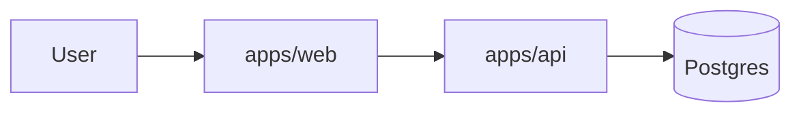

# Architecture: <product>

## 1. Context
<what the system does; external actors and services (C4 level 1, mermaid)>



## 2. Stack
| Layer | Choice | Version | Why |
|---|---|---|---|

## 3. Repository layout
```
apps/web        # Next.js (SEO web) | Vite React SPA (FSD)
apps/admin      # Vite React SPA (optional)
apps/tma        # Telegram Mini App, Vite React + @tma.js/sdk-react (optional)
apps/api        # NestJS + Prisma (+ grammY bot module)
apps/bot        # standalone grammY bot when it scales separately (optional)
packages/shared # Zod schemas = API contract, shared types
prisma/
e2e/
docs/
```
"Where does this code go?" table.

## 4. Domain model
```mermaid
erDiagram
```
Entities, key fields, relations, invariants. Money = integer minor units. Time = UTC.

## 5. API overview
Resource list; full contract in api-contract.md. Error envelope + codes.

## 6. Auth & authorization
Who can do what; session/JWT; ownership checks (no IDOR).

## 7. Key flows
Sequence diagrams for the 2–3 most important flows.

## 8. NFRs → decisions
| NFR | Decision |
|---|---|

## 9. Environments & config
Env vars (names only), local dev (docker-compose), deploy target.

## 10. ADR index
| # | Decision | Status |
|---|---|---|

## 11. Risks & open questions
